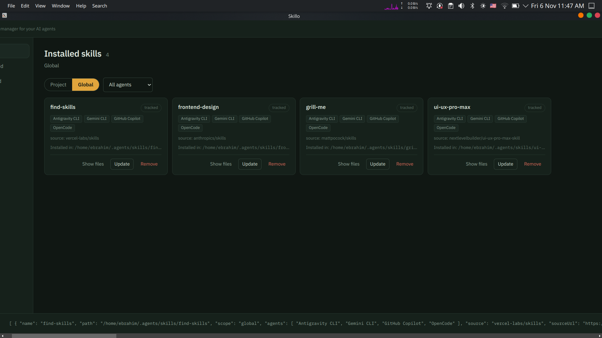

# Skillo

A visual desktop app for the [`skills`](https://skills.sh) CLI (`npx skills`). Everything runs through the real CLI — Skillo is a controller, not a fork.

[](docs/screenshot.png)

## Highlights

- **Built on the real CLI** — every button spawns `npx skills …`; nothing is reimplemented
- **Live search** in *Find & add*: results update as you type (skills.sh API, with a `skills find` fallback when offline)
- **English / العربية** toggle with full RTL mirroring, persisted across restarts
- **Live output strip**: every CLI invocation streams into the bottom bar (expandable to a full log)
- **No horizontal scroll**, ever — desktop shell design with a control-room aesthetic

| Screen                                                                          | Runs under the hood                                              |
|---------------------------------------------------------------------------------|------------------------------------------------------------------|
| Installed skills (Project / Global tabs, filter/sort, bulk actions)             | `skills list --json`                                             |
| Find & add (live search, preview a package)                                     | `skills.sh /api/search` + `skills add <pkg> -l`                  |
| Install (pick skills, **pick target agents or auto-detect**, global, copy mode) | `skills add <pkg> -s … -a … [-g] [--copy] -y`                    |
| Remove (per card, confirm, or multi-select bulk)                                | `skills remove <name> -y [-g] [-a …]`                            |
| Update one / selected / all                                                     | `skills update [names] -y [-g / -p]`                             |
| New skill screen (name + description → written into SKILL.md)                   | `skills init <name>`                                             |
| Advanced → sync                                                                 | `skills experimental_sync -y [--dry-run]`                        |
| Advanced → restore lockfile                                                     | `skills experimental_install [--dry-run / --no-frozen-lockfile]` |
| SKILL.md viewer, health check, backup export/import, operation history          | built-in (local files + `skills list --json`)                    |

## Download

Get the latest build from the [Releases page](https://github.com/EbrahimAhmedDev/skillo/releases/latest).

| OS                         | File                                  | Install                                         |
|----------------------------|---------------------------------------|-------------------------------------------------|
| Fedora / RHEL / openSUSE   | `skillo-x.y.z.x86_64.rpm`             | `sudo dnf install ./skillo-x.y.z.x86_64.rpm`    |
| Ubuntu / Debian / Mint     | `skillo_x.y.z_amd64.deb`              | `sudo apt install ./skillo_x.y.z_amd64.deb`     |
| Any Linux                  | `Skillo-x.y.z.AppImage`               | `chmod +x Skillo-*.AppImage && ./Skillo-*.AppImage` |
| Windows                    | `Skillo-Setup-x.y.z.exe`              | Run the installer                               |
| macOS (Intel)              | `Skillo-x.y.z.dmg`                    | Open the dmg and drag Skillo to Applications    |
| macOS (Apple Silicon)      | `Skillo-x.y.z-arm64.dmg`              | Same as above                                   |

### Requirements

Skillo runs the real `npx skills` CLI, so **Node.js 18+** must be installed on your machine and available on your `PATH`.

### First-run warnings

The builds are not code-signed yet, so your OS may show a warning the first time:

- **Windows (SmartScreen):** click **More info → Run anyway**.
- **macOS:** right-click the app → **Open** (or run `xattr -cr /Applications/Skillo.app` if macOS says the app is damaged).

## Getting started (from source)

Requires Node 18+.

```
git clone https://github.com/EbrahimAhmedDev/skillo.git
cd skillo
npm install

# development (Vite + Electron, hot reload)
npm run dev

# production-style
npm run start
```

## Tests

```
npm test    # parser unit tests against real CLI output fixtures
npm run smoke   # headless E2E: version, list, preview, web search
```

## Desktop launcher & packaging

```
npm run desktop   # write a per-user Linux launcher (~/.local/applications/skillo.desktop)
npm run package   # build AppImage + deb + rpm into release/
```

Building `.rpm` needs `rpmbuild` (`sudo dnf install rpm-build`); building `.deb` needs `dpkg` and `fakeroot`. Windows and macOS installers are built on GitHub Actions (see below).

## Releasing

Releases are built automatically by [GitHub Actions](.github/workflows/build.yml) for Linux (AppImage, deb, rpm), Windows (exe) and macOS (dmg).

1. Bump `version` in `package.json`.
2. Commit and push to `main`.
3. Create and push a tag that matches the version:

```
git tag v0.2.0
git push origin v0.2.0
```

When the workflow finishes, the installers appear under [Releases](https://github.com/EbrahimAhmedDev/skillo/releases). Every push to `main` also builds the packages and uploads them as workflow artifacts (without publishing a release).

## Project structure

```
electron/
  main.cjs          window creation, lifecycle, module wiring
  cli-runner.cjs    spawns the real `npx skills …` and streams output
  ipc.cjs           renderer operations → CLI invocations
  parsers.cjs       CLI text-output parsers (shared with tests)
  net.cjs           skills.sh API + dev-server polling
  history.cjs       local operation log (userData/skillo-history.jsonl)
  smoke.cjs         headless end-to-end harness (ESK_SMOKE=1)
  preload.cjs       contextBridge API (window.skillo)
src/
  App.jsx           frame, topbar, nav rail, cwd, toasts
  api.js            guarded bridge wrapper (browser-safe fallbacks)
  i18n.jsx          EN/AR dictionary + RTL direction provider
  lib/              shared hooks and helpers (debounce, package formatting)
  components/       Skills, Find, InstallModal, Advanced, Create, Settings,
                    RunBar, FileViewer, HealthModal, icons
  styles.css        design tokens + layout
scripts/
  install-desktop.cjs  per-user Linux launcher writer
assets/            app icon (SVG + PNG set)
test/
  parsers.test.cjs
.github/workflows/
  build.yml         build + package on push, publish release on v* tags
```

## License

[MIT](LICENSE)